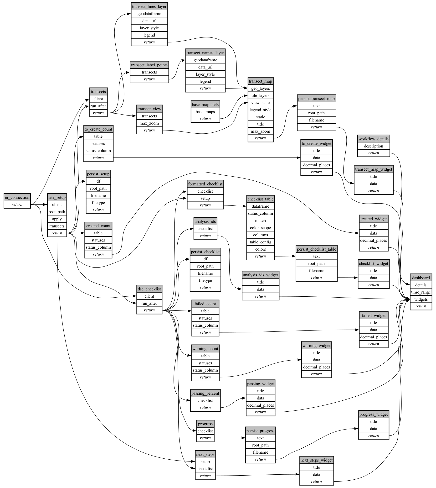

```
# AUTOGENERATED BY ECOSCOPE-WORKFLOWS; see fingerprint in README.md for details

```

```yaml
# fingerprint:
artifacts_sha256_basic: 74cc444ca2aae5ff02e88cdbe8a21a4cdcc187d0ecf1798783038c3c45c3d3fd
artifacts_sha256_strict: ee752af3cf35285811846c291b576f5a4d82f48e380f3655857437407cf48e91
installed_requirements:
- channel: https://repo.prefix.dev/ecoscope-workflows/
  name: ecoscope-platform
  version: {version: ==2.15.1}
- channel: https://repo.prefix.dev/ecoscope-workflows-custom/
  name: ecoscope-workflows-ext-custom
  version: {version: ==0.1.0rc14}
- channel: https://repo.prefix.dev/ecoscope-workflows-custom/
  name: ecoscope-workflows-ext-ste
  version: {version: ==0.0.0rc1}
- channel: file:///tmp/ecoscope-workflows-custom/release/artifacts/
  name: ecoscope-workflows-ext-distance-sample-counts
  version: {version: ==1.1.3.dev1+g216148b6e.d20261028}
- channel: conda-forge
  name: pydeck
  version: {version: ==0.9.2}
params_sha256: 038c4d1d0b0423cb4d68d0913866dd267530c1924eb9077cff314e615cd80dc6
spec_sha256: f8de90e7dd4cc421e149dcdf85a0c81bfa0f52ac2233d57ee270e14419688bda

```

# ecoscope-workflows-dsc-setup-workflow


