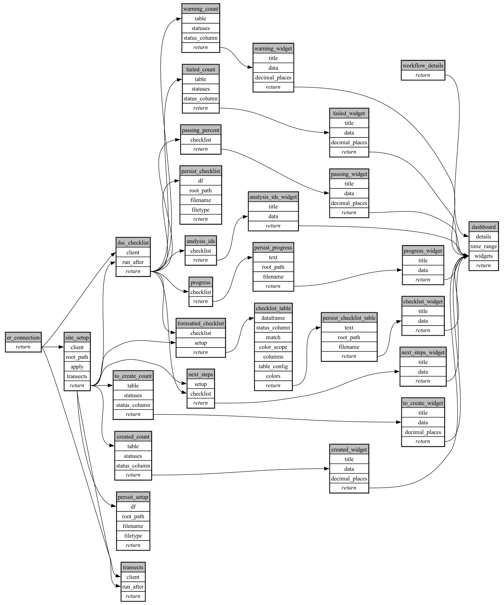

```
# AUTOGENERATED BY ECOSCOPE-WORKFLOWS; see fingerprint in README.md for details

```

```yaml
# fingerprint:
artifacts_sha256_basic: 80252a399fedd6eab80c95c19318b529e377802834287a1ba8ff13de7c33f5d4
artifacts_sha256_strict: 9329da7fe367e9faa468407521ade9e0c11126306ec723b42f5fa20ef2afbe14
installed_requirements:
- channel: https://repo.prefix.dev/ecoscope-workflows/
  name: ecoscope-platform
  version: {version: ==2.27.1}
- channel: https://repo.prefix.dev/ecoscope-workflows-custom/
  name: ecoscope-workflows-ext-custom
  version: {version: ==0.1.5}
- channel: https://repo.prefix.dev/ecoscope-workflows-custom/
  name: ecoscope-workflows-ext-ste
  version: {version: ==0.0.28}
- channel: https://repo.prefix.dev/ecoscope-workflows-custom/
  name: ecoscope-workflows-ext-distance-sample-counts
  version: {version: ==1.1.5}
- channel: conda-forge
  name: pydeck
  version: {version: ==0.9.2}
params_sha256: 4eea82a520c543b34d9e5f7557790d7a42272e3b79c97eac179c3f764eade729
spec_sha256: b4068f4d31d6bd2bfa3d49d141f511ca03083b4a4401744390a1a1b962182874

```

# ecoscope-workflows-dsc-setup-workflow


